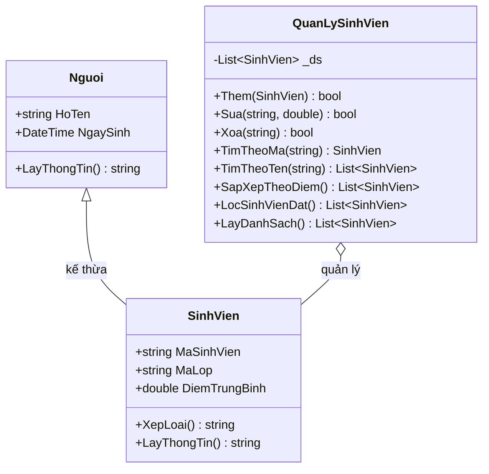

# Lab 03 – Quản lý sinh viên bằng lập trình hướng đối tượng (OOP)

**Học phần:** COMP1019 – Lập trình trên Windows  
**Ngôn ngữ:** C#  
**Loại ứng dụng:** Console  
**Nền tảng:** .NET 8 (`net8.0`)  
**Project:** `Lab03_QuanLySinhVienOOP.csproj`

## 1. Tổng quan

Lab 03 xây dựng chương trình **quản lý sinh viên trên Console**, vận dụng các nguyên lý cơ bản của lập trình hướng đối tượng (Object-Oriented Programming – OOP) cùng với `List<T>`, LINQ, xử lý dữ liệu nhập và menu tương tác.

Người dùng có thể thêm sinh viên, xem danh sách, tìm kiếm, cập nhật điểm, xóa sinh viên, sắp xếp theo điểm và lọc những sinh viên đạt. Mỗi sinh viên gồm mã sinh viên, họ tên, ngày sinh, mã lớp và điểm trung bình. Chương trình tự xác định xếp loại dựa trên điểm.

> **Phạm vi:** Dữ liệu được lưu **trong bộ nhớ** bằng `List<SinhVien>`. Khi thoát chương trình, danh sách sẽ mất; hiện chưa có cơ sở dữ liệu hay chức năng lưu/đọc file. README mô tả **chức năng đã được triển khai trong mã nguồn**, không phải các tính năng dự kiến.

## 2. Mục tiêu học tập

Sau khi thực hiện Lab, có thể:

1. Thiết kế lớp cha `Nguoi` và lớp con `SinhVien` theo quan hệ kế thừa.
2. Áp dụng **đóng gói** qua property và kiểm tra giá trị hợp lệ khi gán điểm.
3. Áp dụng **đa hình** thông qua `virtual`/`override` của phương thức `LayThongTin()`.
4. Tách lớp quản lý dữ liệu (`QuanLySinhVien`) khỏi giao diện nhập/xuất Console (`Program`).
5. Thao tác với `List<SinhVien>` và các truy vấn LINQ: `Any`, `SingleOrDefault`, `Where`, `OrderByDescending`, `ThenBy`.
6. Kiểm soát đầu vào bằng `TryParse`, `TryParseExact` và xử lý `ArgumentException`.
7. Dùng `Dictionary<string, Action>` để ánh xạ lựa chọn menu tới các hàm xử lý.

## 3. Cấu trúc thư mục

```text
Lab03/
├── Lab03_QuanLySinhVienOOP.csproj   # Cấu hình ứng dụng Console .NET 8
├── Program.cs                       # Điểm vào chương trình, menu, nhập/xuất
├── Nguoi.cs                         # Lớp cha chứa họ tên và ngày sinh
├── SinhVien.cs                      # Lớp con, điểm và xếp loại
├── QuanLySinhVien.cs                # Danh sách sinh viên và nghiệp vụ CRUD
└── README.md                        # Tài liệu Lab 03
```

Các thư mục `bin/` và `obj/` (nếu có) là kết quả biên dịch; không phải thành phần nghiệp vụ cần đọc trước.

### 3.1. Sơ đồ quan hệ giữa các lớp



## 4. Phân tích chi tiết mã nguồn

### 4.1. `Nguoi.cs` – Lớp cơ sở

Lớp `Nguoi` định nghĩa thông tin chung:

| Thành phần | Kiểu dữ liệu | Ý nghĩa |
|---|---|---|
| `HoTen` | `string` | Họ và tên người |
| `NgaySinh` | `DateTime` | Ngày sinh |
| `Nguoi(string, DateTime)` | Constructor | Khởi tạo họ tên và ngày sinh |
| `LayThongTin()` | `virtual string` | Trả về chuỗi gồm họ tên và ngày sinh định dạng `dd/MM/yyyy` |

Phương thức `LayThongTin()` được khai báo `virtual` để lớp kế thừa có thể cung cấp cách hiển thị khác.

### 4.2. `SinhVien.cs` – Kế thừa, đóng gói và đa hình

`SinhVien : Nguoi` sử dụng lại họ tên và ngày sinh; bổ sung:

| Thành phần | Kiểu dữ liệu | Vai trò |
|---|---|---|
| `MaSinhVien` | `string` chỉ có getter | Mã được đặt trong constructor; không có setter công khai |
| `MaLop` | `string` | Mã lớp sinh viên |
| `DiemTrungBinh` | `double` | Điểm được kiểm tra từ 0 đến 10 qua property |
| `XepLoai()` | `string` | Phân loại theo điểm trung bình |
| `LayThongTin()` | `override string` | Ghi đè cách hiển thị thành một dòng dữ liệu dạng bảng |

Property `DiemTrungBinh` không chấp nhận giá trị ngoài `[0, 10]`; nếu gán sai sẽ ném `ArgumentException`. Đây là lớp bảo vệ dữ liệu, ngoài kiểm tra ở màn hình nhập.

**Quy tắc xếp loại thực tế:**

| Điểm trung bình | Xếp loại |
|---|---|
| Từ `8.0` đến `10.0` | Giỏi |
| Từ `6.5` đến dưới `8.0` | Khá |
| Từ `5.0` đến dưới `6.5` | Trung bình |
| Từ `0.0` đến dưới `5.0` | Yếu |

Ví dụ: `8.0 → Giỏi`, `6.5 → Khá`, `5.0 → Trung bình`, `4.9 → Yếu`.

**Lưu ý:** `LayThongTin()` của `SinhVien` hiển thị **mã SV, họ tên, lớp, điểm và xếp loại**. Ngày sinh vẫn được lưu trong đối tượng nhưng **không được hiển thị** ở bảng danh sách hiện tại.

### 4.3. `QuanLySinhVien.cs` – Lớp quản lý

Danh sách nội bộ khai báo:

```csharp
private readonly List<SinhVien> _ds = new();
```

Các phương thức nghiệp vụ:

| Phương thức | Chức năng | Kết quả |
|---|---|---|
| `Them(SinhVien sv)` | Thêm sinh viên nếu mã chưa tồn tại theo kiểm tra của phương thức | `true` nếu thêm; `false` nếu trùng |
| `LayDanhSach()` | Trả về danh sách sinh viên hiện có | `List<SinhVien>` |
| `TimTheoMa(string ma)` | Tra cứu theo mã không phân biệt chữ hoa/thường | Sinh viên hoặc `null` |
| `TimTheoTen(string tuKhoa)` | Tìm chuỗi con trong họ tên, không phân biệt hoa/thường khi chuyển về chữ thường | Danh sách phù hợp |
| `Sua(string ma, double diemMoi)` | Cập nhật điểm của sinh viên tìm được | `true` nếu có; `false` nếu không thấy; có thể ném lỗi nếu điểm sai |
| `Xoa(string ma)` | Xóa sinh viên có mã khớp | `true` nếu đã xóa ít nhất một người |
| `SapXepTheoDiem()` | Điểm giảm dần; trùng điểm thì theo tên tăng dần | Danh sách đã sắp xếp mới |
| `LocSinhVienDat()` | Chỉ lấy sinh viên có điểm `>= 5.0` | Danh sách sinh viên đạt |

Ví dụ biểu thức LINQ dùng trong chương trình:

```csharp
_ds.OrderByDescending(x => x.DiemTrungBinh)
   .ThenBy(x => x.HoTen)
   .ToList();
```

Đoạn trên trả về **danh sách sắp xếp mới**, không sắp xếp trực tiếp `_ds`. Lựa chọn số 7 chỉ thay đổi thứ tự **hiển thị ở lần đó**, không làm thay đổi thứ tự lưu trữ ban đầu.

### 4.4. `Program.cs` – Tương tác Console

`Main` khởi tạo một đối tượng quản lý dùng chung:

```csharp
private static readonly QuanLySinhVien QuanLy = new();
```

Sau đó tạo `Dictionary<string, Action>` để gắn các mã lựa chọn `"1"` đến `"8"` với hàm tương ứng, gọi `TryGetValue` để thực thi. Chương trình tiếp tục lặp đến khi người dùng chọn `0`.

| Phương thức | Mục đích |
|---|---|
| `InMenu()` | Xóa màn hình Console và in các mục menu |
| `ThemSinhVien()` | Nhập sinh viên, kiểm tra trùng mã, tạo đối tượng |
| `InDanhSach(List<SinhVien>)` | Hiển thị bảng hoặc thông báo danh sách trống |
| `TimTheoMa()` | Nhập mã và hiển thị sinh viên được tìm thấy |
| `TimTheoTen()` | Nhập từ khóa tên và in kết quả tìm kiếm |
| `SuaDiem()` | Chọn mã sinh viên và nhập điểm mới |
| `XoaSinhVien()` | Xóa theo mã và hiển thị kết quả |
| `DocChuoi(string)` | Đọc một dòng văn bản từ bàn phím |
| `DocDiem(string)` | Nhập lặp đến khi được số thực hợp lệ từ 0 đến 10 |
| `DocNgay(string)` | Nhập lặp đến khi ngày đúng một trong bốn định dạng hỗ trợ |

## 5. Hướng dẫn cài đặt và chạy

### 5.1. Yêu cầu môi trường

- Hệ điều hành có thể chạy .NET 8 Console (Windows là môi trường phù hợp với học phần).
- **.NET 8 SDK** được cài đặt.
- Visual Studio 2022 có workload .NET desktop development, **hoặc** VS Code/terminal có lệnh `dotnet`.

Kiểm tra SDK:

```powershell
dotnet --version
```

### 5.2. Chạy trong Visual Studio

1. Giải nén repository.
2. Mở file `Lab03/Lab03_QuanLySinhVienOOP.csproj` bằng Visual Studio.
3. Kiểm tra project đã tải đầy đủ và chọn cấu hình Debug.
4. Nhấn `Ctrl + F5` để chạy không debug, hoặc `F5` để debug.
5. Chọn một chức năng theo menu hiển thị trên Console.

### 5.3. Chạy bằng terminal / VS Code

Từ **thư mục gốc repository**, chạy:

```powershell
dotnet run --project .\Lab03\Lab03_QuanLySinhVienOOP.csproj
```

Hoặc chuyển tới thư mục `Lab03`:

```powershell
cd Lab03
dotnet restore
dotnet run
```

> Nếu lệnh `dotnet` không nhận diện được, cần cài .NET SDK và mở lại terminal. Nếu Console bị xóa sau mỗi vòng, đó là hành vi của `Console.Clear()` trong `InMenu()`.

## 6. Menu và hướng dẫn sử dụng

```text
===== QUAN LY SINH VIEN =====
1. Them sinh vien
2. Xuat danh sach
3. Tim sinh vien theo ma
4. Tim sinh vien theo ten
5. Sua diem trung binh
6. Xoa sinh vien
7. Sap xep theo diem giam dan
8. Loc sinh vien dat
0. Thoat
Chon chuc nang:
```

| Chọn | Chức năng | Cách sử dụng |
|---|---|---|
| `1` | Thêm sinh viên | Nhập mã, họ tên, ngày sinh, mã lớp, điểm |
| `2` | Xuất danh sách | Xem bảng toàn bộ sinh viên hiện có |
| `3` | Tìm theo mã | Nhập mã cần tìm, ví dụ `SV01` |
| `4` | Tìm theo tên | Nhập một phần họ tên, ví dụ `an` |
| `5` | Sửa điểm | Nhập mã SV đang có rồi nhập điểm mới |
| `6` | Xóa sinh viên | Nhập mã của sinh viên cần xóa |
| `7` | Sắp xếp theo điểm | Xem kết quả theo điểm giảm dần |
| `8` | Lọc sinh viên đạt | Xem sinh viên có điểm từ `5.0` trở lên |
| `0` | Thoát | Kết thúc phiên làm việc |

Sau các chức năng khác `0`, màn hình yêu cầu nhấn Enter để trở lại menu.

### Ví dụ minh họa thao tác

Thêm ba sinh viên bằng chức năng `1` (thực hiện ba lần):

| Mã | Họ tên | Ngày sinh | Lớp | Điểm | Xếp loại suy ra |
|---|---|---|---|---:|---|
| `SV01` | Nguyễn An | `15/03/2005` | `CNTT1` | `8.5` | Giỏi |
| `SV02` | Trần Bình | `20/09/2005` | `CNTT1` | `6.5` | Khá |
| `SV03` | Lê Chi | `01/01/2006` | `CNTT2` | `4.0` | Yếu |

Sau đó:

1. Chọn `2`: xuất đủ ba sinh viên.
2. Chọn `3`, nhập `sv01`: tìm thấy `SV01` (không phân biệt hoa/thường).
3. Chọn `4`, nhập `bình`: tìm thấy `Trần Bình`.
4. Chọn `7`: hiển thị thứ tự `SV01 (8.5)`, `SV02 (6.5)`, `SV03 (4.0)`.
5. Chọn `8`: chỉ còn `SV01` và `SV02` trong kết quả lọc.
6. Chọn `5`, sửa `SV03` lên `7.0`: sinh viên này được xếp loại **Khá** và xuất hiện khi lọc sinh viên đạt.
7. Chọn `6`, xóa `SV02`: danh sách còn hai sinh viên.

Đây là **kịch bản kiểm thử minh họa** suy ra từ chức năng mã nguồn, không phải ảnh chụp/kết quả thực thi được cung cấp trong repository.

## 7. Quy tắc kiểm tra dữ liệu

| Dữ liệu | Quy tắc trong mã nguồn | Khi nhập sai |
|---|---|---|
| Lựa chọn menu | Các chuỗi `0` đến `8` | In thông báo lựa chọn không hợp lệ |
| Mã sinh viên | Kiểm tra trùng bằng `TimTheoMa()` trước khi thêm | Báo mã đã tồn tại và không thêm |
| Ngày sinh | Chấp nhận `dd/MM/yyyy`, `d/M/yyyy`, `dd-MM-yyyy`, `d-M-yyyy` | Yêu cầu nhập lại |
| Điểm trung bình | Số thực từ `0` đến `10`, bao gồm hai đầu mút | Yêu cầu nhập lại |
| Dấu thập phân của điểm | `DocDiem()` sử dụng `InvariantCulture` | Nên nhập dấu chấm: `7.5` |
| Mã không tồn tại khi sửa/xóa | Tra cứu trong danh sách | Thông báo không tìm thấy |

Không có bước kiểm tra riêng để bắt buộc họ tên/mã lớp phải khác rỗng, hoặc để giới hạn ngày sinh trong quá khứ. Không nên mô tả các kiểm tra này là chức năng đã có.

## 8. Bộ test case đề xuất

| Mã test | Thao tác / Dữ liệu | Kết quả mong đợi |
|---|---|---|
| TC01 | Chọn `2` khi chưa thêm dữ liệu | `Danh sách trống.` |
| TC02 | Thêm `SV01` hợp lệ, chọn `2` | Hiển thị `SV01` cùng tên, lớp, điểm, xếp loại |
| TC03 | Thêm lại mã `SV01` | Báo mã đã tồn tại |
| TC04 | Thêm `sv01` sau khi đã có `SV01` qua menu | Bị từ chối do tra cứu mã không phân biệt hoa/thường |
| TC05 | Nhập ngày `31/02/2005` | Yêu cầu nhập lại |
| TC06 | Nhập ngày `1-9-2005` | Được chấp nhận |
| TC07 | Nhập điểm `-1`, `11`, chữ `abc` | Yêu cầu nhập lại cho đến khi hợp lệ |
| TC08 | Nhập điểm `0`, `5`, `6.5`, `8`, `10` | Phân loại tương ứng Yếu, Trung bình, Khá, Giỏi, Giỏi |
| TC09 | Tìm mã `sv01` khi dữ liệu là `SV01` | Tìm thấy |
| TC10 | Tìm tên bằng một phần tên khác chữ hoa/thường | Trả về các sinh viên phù hợp |
| TC11 | Sửa điểm một mã không tồn tại | Báo không tìm thấy |
| TC12 | Sắp xếp ba sinh viên có điểm `4`, `9`, `6` | Thứ tự hiển thị `9`, `6`, `4` |
| TC13 | Lọc danh sách có điểm `4.9`, `5.0`, `9.0` | Chỉ hiện sinh viên điểm `5.0` và `9.0` |
| TC14 | Xóa mã sinh viên có tồn tại | Báo xóa thành công |
| TC15 | Chọn menu `99` hoặc chữ bất kỳ | Báo lựa chọn không hợp lệ; chương trình tiếp tục |

## 9. Kiến thức lập trình được áp dụng

- **Inheritance (kế thừa):** `SinhVien` sử dụng lại dữ liệu và constructor của `Nguoi` thông qua `base(...)`.
- **Encapsulation (đóng gói):** `_diem` là trường riêng; setter `DiemTrungBinh` kiểm tra giá trị.
- **Polymorphism (đa hình):** phương thức `LayThongTin()` ở lớp con ghi đè phương thức `virtual` ở lớp cha.
- **Collection:** sử dụng `List<SinhVien>` để quản lý nhiều đối tượng.
- **LINQ:** truy vấn, lọc và sắp xếp ngắn gọn.
- **Delegate:** `Action` được dùng để gọi các chức năng tương ứng với lựa chọn menu.
- **Exception:** `ArgumentException` hỗ trợ báo lỗi khi gán điểm ngoài phạm vi cho phép.

## 10. Giới hạn hiện tại và hướng phát triển

**Giới hạn nhận thấy từ mã nguồn:**

- Danh sách không được lưu xuống file hay cơ sở dữ liệu; khởi động lại sẽ mất dữ liệu.
- `Them()` của lớp quản lý kiểm tra trùng mã bằng so sánh phân biệt chữ hoa/thường, trong khi `TimTheoMa()` lại không phân biệt. Giao diện Console đã kiểm tra trước nên hạn chế được sự không nhất quán này, nhưng nếu gọi lớp quản lý trực tiếp thì có thể xuất hiện mã khác nhau chỉ ở kiểu chữ.
- `Xoa()` sử dụng so sánh mã phân biệt hoa/thường, khác với `TimTheoMa()`; để chắc chắn xóa được, nên nhập đúng chữ hoa/thường của mã đã lưu.
- `LayDanhSach()` trả về trực tiếp danh sách nội bộ; mã gọi có thể thay đổi danh sách ngoài các hàm nghiệp vụ.
- Chưa có ràng buộc bắt buộc các trường văn bản có nội dung.
- Chưa có tính năng xuất báo cáo, lưu file, tìm kiếm nâng cao hoặc giao diện đồ họa.

**Gợi ý phát triển (chưa có trong phiên bản này):** thống nhất quy tắc so sánh mã, kiểm tra đầu vào mạnh hơn, thêm thao tác cập nhật nhiều trường, lưu JSON/SQL Server, phân trang danh sách hoặc chuyển sang WinForms.

## 11. Kết luận

Lab 03 minh họa cách xây dựng một chương trình quản lý sinh viên nhỏ nhưng có phân lớp rõ ràng: **mô hình dữ liệu** (`Nguoi`, `SinhVien`), **nghiệp vụ** (`QuanLySinhVien`) và **giao diện Console** (`Program`). Những phần quan trọng nhất là kế thừa, ghi đè phương thức, kiểm tra điểm qua property và xử lý danh sách với LINQ.
